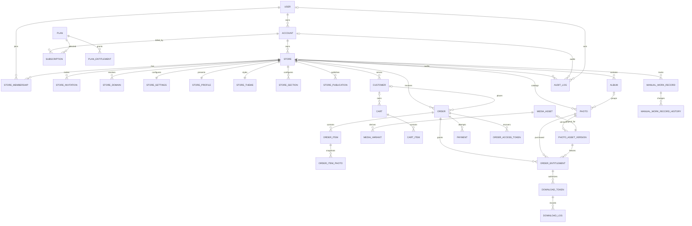

# Documento de arquitectura técnica

**Versión:** 1.2 — 17 de noviembre de 2026  
**Estado:** Especificación técnica consolidada para revisión; no autoriza por sí sola la creación de migraciones definitivas.

## 1. Objetivo y alcance

Definir módulos, modelo de datos, aislamiento multi-tenant, reglas de integridad, almacenamiento, compras y operación del MVP como monolito modular.

El MVP contiene una tienda digital de fotografías y álbumes, suscripciones por cuenta propietaria, equipos con roles por tienda, pedidos/pagos/derechos de descarga y un registro privado de ventas externas y trabajos ya realizados. No incluye catálogo público de servicios, cotizaciones, reservas, contratación ni marketplace.

## 2. Stack de referencia

- PostgreSQL como base de datos principal.
- Backend Node.js.
- Frontend React + Vite + TypeScript + Tailwind como stack de referencia.
- VPS propia inicialmente.
- Archivos en almacenamiento privado administrado exclusivamente por backend, con abstracción para migrar a object storage.
- Docker como opción de empaquetado/despliegue a confirmar durante el descubrimiento técnico.

No fijar versiones de runtime, framework backend, ORM, autenticación o procesamiento de imágenes hasta inventariar el entorno y seleccionar dependencias compatibles. PostgreSQL debe ser la autoridad de integridad para claves, restricciones, índices únicos y transacciones.

## 3. Arquitectura de alto nivel

Monolito modular con contratos internos claros. Una aplicación backend expone API REST y coordina transacciones entre módulos. No introducir microservicios en el MVP.

Módulos:

1. **Identity & Access:** usuarios, credenciales, sesiones, verificación y recuperación.
2. **Accounts:** cuenta comercial propietaria y perfil de facturación.
3. **Stores & Tenant Resolution:** tiendas, dominios, resolución de tenant y publicación.
4. **Memberships & Authorization:** invitaciones, membresías, roles y permisos por tienda.
5. **Plans & Subscriptions:** planes, entitlements y suscripciones por cuenta.
6. **Storefront:** plantilla, configuración, secciones y snapshots publicados.
7. **Digital Catalog:** álbumes, fotografías y precios.
8. **Media:** originales privados, versiones, variantes, procesamiento y storage.
9. **Orders & Payments:** carritos, pedidos, pagos y derechos digitales.
10. **Manual Activity:** ventas externas y trabajos/servicios realizados registrados por el fotógrafo.
11. **Customers & Notifications:** compradores, acceso de invitado y comunicaciones.
12. **Audit & Operations:** auditoría append-only, observabilidad y tareas de mantenimiento.

No crear un módulo `ProfessionalServices` en el MVP. El registro interno de trabajos realizados no es un catálogo público ni un flujo de cotización o contratación.

## 4. Reglas de dominio y facturación

### 4.1 User, Account y Store

- `User` es la identidad autenticada.
- `Account` es el sujeto comercial y de facturación. Tiene un único propietario `owner_user_id` en v1.
- `Store.account_id` define la propiedad comercial de la tienda.
- Una cuenta puede poseer varias tiendas cuando sus entitlements lo permiten.
- `StoreMembership` relaciona `User` con `Store`; no se usa `account_id` en la membresía porque el acceso es por tienda.
- El propietario de la cuenta tiene acceso OWNER implícito a todas sus tiendas. Se conserva una membresía explícita OWNER para trazabilidad.

**Punto de consistencia pendiente:** una decisión propone `UNIQUE(Account.owner_user_id)`, pero otra respuesta provisional permite que un `User` sea propietario de más de una `Account`. Esas dos reglas no pueden coexistir. No fijar el índice global `UNIQUE(owner_user_id)` en una migración hasta resolverlo. Sí se mantiene un único propietario por cada Account en v1.

### 4.2 Suscripción Business por cuenta

- `Subscription.account_id` referencia a la cuenta propietaria.
- No se incluye `SubscriptionStore` en v1.
- La suscripción Business cubre las tiendas cuyo `Store.account_id` coincide con la cuenta suscriptora, hasta el límite configurado por entitlements.
- Base e Intermedio permiten una tienda por cuenta; Business permite múltiples tiendas según `stores.max`.
- El equipo se habilita por entitlement (`team.enabled`, límites configurables si se aprueban).
- Los colaboradores invitados no pagan ni necesitan una suscripción propia para colaborar. La capacidad de invitar se valida contra el plan de la cuenta propietaria.
- La facturación de la suscripción corresponde al propietario de la cuenta, no a cada colaborador.
- Debe existir como máximo una suscripción abierta por cuenta (índice único parcial para estados abiertos).

### 4.3 Compras habilitadas

Se permite crear nuevas compras cuando la cuenta tiene suscripción en estado habilitado (`trial` o `active`), la tienda está activa y `sales_paused = false`. La política final de cancelación inmediata o al fin del período debe definirse.

Con suscripción `expired`, `cancelled` o `suspended`, la tienda publicada puede seguir mostrando catálogo si su estado lo permite, pero no acepta nuevas compras (`STORE_PURCHASES_DISABLED`). Los derechos previos no se revocan por expiración comercial.

## 5. Modelo entidad-relación

Los nombres siguientes son canónicos a nivel de dominio; los nombres físicos y convenciones finales se fijarán en migraciones. Toda entidad operativa tenant-scoped incluye `store_id` directamente o queda ligada mediante una FK compuesta inequívoca.

### 5.1 Identidad, cuenta y equipo

- `users`: `id`, email normalizado único, `password_hash`, `email_verified_at`, `status`, timestamps.
- `user_sessions` / tokens de verificación y recuperación: identidad, hash del token, expiración, revocación y timestamps.
- `accounts`: `id`, `owner_user_id`, estado y datos comerciales/de facturación. Una cuenta tiene un único propietario en v1.
- `account_profiles`: `account_id`, nombre visible y perfil no sensible.
- `stores`: `id`, `account_id`, nombre, slug, `status`, `publication_status`, `sales_paused`, timestamps. Índices/unique para slug y `(id, account_id)`.
- `store_memberships`: `id`, `store_id`, `user_id`, `role` (`OWNER`, `ADMIN`, `PHOTOGRAPHER`, `EDITOR`), `status`, `invited_by_user_id`, `accepted_at`. `UNIQUE(store_id, user_id)`.
- `store_invitations`: `store_id`, email normalizado, rol propuesto, hash del token, expiración, estado y autor de invitación. No concede acceso hasta aceptación.
- `store_domains`: `store_id`, hostname normalizado único, tipo, verificación, estado y dominio primario.

Los colaboradores pueden ser miembros de varias tiendas con roles diferentes y no necesitan ser propietarios de una Account.

### 5.2 Planes y suscripciones

- `plans`: código (`base`, `intermediate`, `business`), nombre y estado.
- `plan_entitlements`: `plan_id`, `feature_key`, valor/tipo, límites y vigencia de configuración.
- `subscriptions`: `account_id`, `plan_id`, estado, inicio/fin de trial, período actual y timestamps.
- `subscription_events`: historial append-only de cambios de plan/estado y eventos de facturación.

No guardar una suscripción por tienda. Resolver la cobertura por la relación Account → Stores. Las funcionalidades consultan entitlements, no condiciones dispersas como `if plan === 'BUSINESS'`.

### 5.3 Configuración y publicación

- `store_settings`: configuración general 1:1 con tienda.
- `store_profiles`: identidad pública 1:1 con tienda.
- `store_themes`: `template_key` (inicialmente `nocturne-cyanotype`) y tokens permitidos.
- `store_sections`: `section_key`, enabled, position y contenido JSONB validado.
- `store_publications`: snapshots versionados e inmutables de la configuración publicada; como máximo una publicación actual por tienda.

El storefront público lee la publicación actual, nunca el borrador. Incluir `schema_version` en snapshots y validar/migrar snapshots cuando cambie el esquema de plantilla.

### 5.4 Catálogo y álbumes

- `albums`: `id`, `store_id`, título, descripción, portada, precio, moneda, estado, orden y timestamps.
- `photos`: `id`, `store_id`, `album_id` nullable, título, descripción, precio individual, moneda, estado, orden y timestamps.
- Una foto pertenece a cero o un álbum. No se usa tabla puente N:M.
- Debe existir `UNIQUE(id, store_id)` en ambas tablas y FK compuesta `(photos.album_id, photos.store_id) → albums(id, store_id)`.
- El borrado del álbum debe ofrecer dos operaciones de dominio: liberar fotos (`album_id = NULL`) o archivar álbum y fotos. No borrar en cascada las fotos.
- Los estados de publicación/archivo se controlan por servicio y restricciones de estado; una foto archivada no se ofrece en el catálogo.

### 5.5 Media y versionado

- `media_assets`: `id`, `store_id`, `storage_driver`, `storage_key`, checksum SHA-256, MIME real, tamaño, dimensiones, estado de procesamiento, timestamps y metadatos técnicos.
- `photo_asset_versions`: `id`, `store_id`, `photo_id`, `media_asset_id`, `version_number`, `is_current`, `created_at`, `retired_at`.
- `media_variants`: `id`, `media_asset_id`, tipo derivado (`thumbnail`, `web`, `watermarked_preview`), `storage_key`, MIME, tamaño, checksum, estado y metadatos.

Cardinalidades e invariantes:

- `Photo 1 → N PhotoAssetVersion`.
- Cada `PhotoAssetVersion` referencia exactamente un `MediaAsset`.
- Un `MediaAsset` puede estar asociado como máximo a una `PhotoAssetVersion`; puede existir sin versión para otros usos controlados (por ejemplo logo o portada), sin reutilizarlo como original de varias versiones.
- `MediaAsset 1 → N MediaVariant`.
- Una foto tiene como máximo una versión actual: índice único parcial `WHERE is_current = true` por `photo_id`.
- `UNIQUE(photo_id, version_number)`, `UNIQUE(media_asset_id)` y `UNIQUE(id, photo_id, store_id)` en versiones para permitir FKs compuestas desde snapshots y entitlements.
- Una versión no cambia de foto, tienda ni asset. Una versión referenciada por un entitlement no se elimina.
- Las variantes son regenerables y nunca sustituyen al original.

El original permanece privado. `MediaVariant` no incluye una variante pública de tipo `original`.

### 5.6 Clientes, carritos y compras

- `customers`: `id`, `store_id`, `user_id` nullable, email normalizado, nombre visible y timestamps. La vinculación posterior de un invitado requiere prueba de identidad.
- `carts`: `id`, `store_id`, `customer_id` nullable, hash de token de invitado, estado y timestamps. Como máximo un carrito abierto por identidad/tienda según la estrategia de unicidad.
- `cart_items`: `cart_id`, `store_id`, `item_type` (`photo`/`album`), referencia del ítem y datos visuales no autoritativos. El precio no se considera fuente de verdad. Preferir `photo_id` y `album_id` nullable con un `CHECK` que exija exactamente uno, y que el tipo coincida con la columna no nula, para evitar una referencia polimórfica sin FK.
- `orders`: `id`, `store_id`, `customer_id` nullable, email de invitado, `order_number`, estado comercial, subtotal/total, moneda y timestamps. No contiene `payment_status` duplicado ni `source = manual`.
- `order_items`: líneas y snapshots de título, precio, cantidad, moneda y tipo de compra.
- `order_item_photos`: composición congelada de cada pedido; cada fila registra `photo_id`, `photo_asset_version_id`, origen individual/álbum y snapshots necesarios. `UNIQUE(order_id, photo_id)` evita duplicados.
- `payments`: intentos de pago, proveedor/método, referencia externa, importe, moneda, estado, fechas de confirmación y actor que confirmó cuando sea manual. Un pedido puede tener varios intentos; un pago confirmado debe cubrir el total. Aplicar unique a `provider_payment_id` cuando exista y a la clave de idempotencia dentro del alcance definido.
- `order_entitlements`: derecho de descarga generado tras confirmar el pedido; referencia `order_id`, `store_id`, `photo_id`, `photo_asset_version_id`, fila de composición/origen, `granted_at`, `revoked_at` y motivo. `UNIQUE(order_id, photo_id)`.
- `download_tokens`: token hasheado, entitlement, expiración, propósito, uso/revocación y metadatos mínimos.
- `download_logs`: tenant, entitlement/token, resultado, bytes, IP y request ID; minimizar PII y definir retención.
- `order_access_tokens`: token hasheado de acceso a pedido invitado, expiración y revocación.

Los snapshots de composición de álbum congelan las fotos y versiones incluidas al checkout. Las fotos agregadas al álbum después no se agregan a una compra anterior.

### 5.7 Actividad manual

- `manual_work_records`: `id`, `store_id`, tipo de registro (venta externa o trabajo/servicio realizado), título/descripción, cliente opcional si corresponde, fecha, importe/moneda cuando aplique, estado, autor y timestamps.
- `manual_work_record_history`: historial append-only con `record_id`, `store_id`, actor, `change_type`, estado anterior/nuevo, diff JSONB saneado, nota y `created_at`.

`ManualWorkRecord` es un registro operativo interno, no una venta de la plataforma. No se transforma en `Order`, `Payment` ni `OrderEntitlement`, no concede descargas y no activa cobros. La analítica debe separar ventas online confirmadas de importes externos declarados manualmente.

No crear tablas `professional_services`, `service_inquiries`, `quotes`, `bookings` ni entidades de contratación en el MVP.

### 5.8 Auditoría

- `audit_logs`: append-only; `account_id`, `store_id` y `actor_user_id` como referencias lógicas cuando corresponda; `actor_type` (`user`, `system`, `platform_admin` reservado), `action`, `entity_type`, `entity_id`, `before`/`after` saneados, metadata JSONB, request ID, IP, user agent y timestamp.
- Las referencias pueden ser lógicas sin FK para preservar trazas cuando una entidad se anonimiza o retiene de forma independiente.
- Prohibir UPDATE/DELETE en auditoría y en historial de actividad; correcciones mediante nuevos eventos.

## 6. Diagrama ER conceptual

El diagrama muestra las relaciones principales. Los detalles de FKs compuestas, estados e índices se especifican en las subsecciones anteriores y no se sustituyen por el dibujo.

**Nota sobre `USER → ACCOUNT`:** el dibujo permite visualizar la relación de propiedad, pero la cardinalidad máxima por usuario depende de resolver la contradicción sobre `UNIQUE(accounts.owner_user_id)`. No generar una migración basándose solo en esa línea del diagrama.

## 7. Cardinalidades y restricciones de integridad

- `User 1 → N StoreMembership`; `Store 1 → N StoreMembership`; unique `(store_id, user_id)`.
- `Account 1 → N Store`; `Store N → 1 Account`.
- `Account 1 → N Subscription` histórica, con máximo una suscripción abierta por cuenta mediante índice parcial.
- `Plan 1 → N PlanEntitlement` y `Plan 1 → N Subscription`.
- `Store 1 → N Album`; `Album 1 → N Photo` opcional desde Photo.
- `Photo 1 → N PhotoAssetVersion`; una sola actual por foto.
- `PhotoAssetVersion 1 → 1 MediaAsset`; un asset no se reutiliza para varias versiones.
- `MediaAsset 1 → N MediaVariant`.
- `Order 1 → N OrderItem`; `OrderItem 1 → N OrderItemPhoto`.
- `Order 1 → N Payment` (intentos); los pagos parciales no se consideran confirmación válida.
- `Order 1 → N OrderEntitlement`; unique `(order_id, photo_id)`. Un trigger o una operación transaccional protegida impide insertar derechos si la orden no está confirmada.
- `OrderEntitlement N → 1 PhotoAssetVersion`, siempre de la misma foto y tienda.
- `ManualWorkRecord 1 → N ManualWorkRecordHistory`.
- `AuditLog` puede ser global, de cuenta o de tienda; sus referencias son lógicas.

### 7.1 Claves compuestas tenant-safe

Para entidades tenant-scoped crear claves únicas `(id, store_id)` y FKs compuestas que incluyan `store_id`. Ejemplos:

- `photos(album_id, store_id) → albums(id, store_id)`.
- `photo_asset_versions(photo_id, store_id) → photos(id, store_id)`.
- `order_item_photos(order_id, store_id) → orders(id, store_id)` y `(photo_asset_version_id, photo_id, store_id)` contra la versión correcta.
- `order_entitlements(order_id, store_id) → orders(id, store_id)` y referencias compuestas a foto/versión.
- `cart_items(cart_id, store_id)` y la referencia del objeto deben validar el mismo tenant.

No confiar en que la aplicación siempre envíe IDs correctos: la base debe rechazar asociaciones entre tiendas distintas.

### 7.2 Índices y constraints adicionales

- `store_domains`: unique global por hostname normalizado y unique parcial para un único dominio primario por tienda.
- `store_publications`: unique parcial para una publicación actual por tienda.
- `subscriptions`: unique parcial para una suscripción abierta por cuenta, usando la definición aprobada de estados abiertos.
- `orders`: unique `(store_id, order_number)`.
- `payments`: unique por identificador de pago del proveedor cuando no sea NULL; unique de idempotencia según el alcance acordado.
- `carts`: unique parcial para carrito abierto por cliente/identidad invitada y tienda, según la estrategia final de identidad.
- `cart_items`: `CHECK` que exija exactamente un target (foto o álbum) y coherencia con `item_type`.
- `photos`: índice por `(store_id, status, album_id, sort_order)` según consultas reales.
- `manual_work_records`: índices por `(store_id, status, occurred_at)` y `(store_id, record_type, occurred_at)`.
- `manual_work_record_history`: índices por `(record_id, created_at)` y `(store_id, created_at)`.
- `audit_logs`: índices por `store_id/created_at`, `account_id/created_at`, `actor_user_id/created_at` y `action/created_at`; GIN de metadata solo si los casos de consulta lo justifican.
- No agregar índices por anticipado sin revisar planes de consulta y costo de escritura.

### 7.3 Resultado de la revisión del ERD

El modelo actualizado cubre los dominios solicitados y corrige varias ambigüedades del esquema anterior:

1. La identidad de login (`User`) queda separada de la entidad comercial (`Account`), y `Store` pertenece a `Account`.
2. La suscripción y sus entitlements se resuelven por cuenta propietaria; no se introduce una suscripción por tienda.
3. `StoreMembership` vincula usuarios directamente con tiendas, con rol y estado por tienda; un colaborador no necesita una suscripción individual.
4. El catálogo usa `Photo.album_id` nullable y FK compuesta, no una relación N:M.
5. El original se separa de la identidad lógica `Photo` mediante `PhotoAssetVersion`; los pedidos congelan la versión exacta.
6. `Order`, `Payment`, `OrderItemPhoto` y `OrderEntitlement` quedan separados. El pedido no duplica `payment_status` ni usa `source = manual`.
7. `ManualWorkRecord` y su historial representan actividad externa/interna ya realizada, sin crear pedidos, pagos o derechos.
8. El aislamiento no depende solo del middleware: se refuerza con `store_id`, FKs compuestas, constraints, autorización y pruebas.
9. La única contradicción de cardinalidad pendiente que bloquea una constraint definitiva es si `User` puede ser propietario de más de una `Account` frente a un índice global `UNIQUE(owner_user_id)`.
10. Se admite que `MediaAsset` exista para usos de identidad/portada sin estar ligado a una versión de foto; cuando se usa como original de `PhotoAssetVersion`, no puede reutilizarse en otra versión.

La revisión es conceptual y documental; todavía no equivale a ejecutar migraciones ni a probar el esquema en una instancia PostgreSQL real.

## 8. Multi-tenancy y autorización

### 8.1 Clases de datos

- **Globales:** `users`, `plans`, `plan_entitlements`.
- **De cuenta:** `accounts`, `account_profiles`, `subscriptions`, `subscription_events`.
- **Tenant-scoped:** tiendas, membresías, invitaciones, dominios, configuración, catálogo, media, clientes, carritos, pedidos, pagos, entitlements, tokens, registros manuales e historial.
- **Transversales:** `audit_logs` y `download_logs`, con `store_id` cuando aplique y referencias lógicas.

### 8.2 Resolución del tenant

- **Storefront público:** hostname validado → `store_domains` → `store_id`.
- **Panel autenticado:** sesión `User` + `store_id` resuelto/seleccionado → membresía activa y rol. El `store_id` enviado por el cliente nunca es autorización suficiente.
- **Propietario:** `Account.owner_user_id` otorga acceso OWNER implícito a las tiendas de esa cuenta; registrar membresía OWNER para trazabilidad.
- **Invitación:** token válido y aceptado → membresía activa; una invitación pendiente no da acceso.
- **Cliente:** sesión de cliente o token de pedido verificado, siempre limitado a la tienda y compra correspondientes.
- **Descarga:** entitlement → order → store → versión → asset. Nunca aceptar ruta o `storage_key` arbitrario del cliente.
- **Webhook futuro:** referencia externa verificada → payment/order; no resolver tenant desde campos arbitrarios del payload.

### 8.3 Reglas de aislamiento

- Todas las consultas tenant-scoped filtran por `store_id` y por el ID del recurso.
- El tenant proviene de contexto confiable, no de parámetros libres.
- Las membresías suspendidas/removidas no autorizan.
- Los permisos de rol y los entitlements comerciales se evalúan de forma independiente.
- El propietario de la cuenta administra billing; un colaborador ADMIN no adquiere la propiedad de la suscripción.
- RLS de PostgreSQL puede añadirse como defensa adicional, pero no sustituye filtros, autorización, FKs ni pruebas.
- Probar acceso cruzado entre dos tiendas con IDs válidos y hostnames diferentes.

### 8.4 Roles

Roles por tienda: `OWNER`, `ADMIN`, `PHOTOGRAPHER`, `EDITOR`. El propietario de la cuenta tiene OWNER implícito en todas sus tiendas. Los roles describen perfiles; la matriz granular de permisos debe implementarse centralizadamente y probarse en backend. La habilitación del equipo es un entitlement de la cuenta, no una suscripción individual del colaborador.

## 9. Almacenamiento y pipeline de fotografías

### 9.1 Carga inicial

1. Recibir el archivo en un temporal fuera del webroot.
2. Validar tamaño, extensión, MIME real, dimensiones, decodificación y límites de píxeles.
3. Calcular SHA-256 y crear `MediaAsset` con estado `pending`.
4. Encolar procesamiento asíncrono y marcar `processing`.
5. Generar derivados: miniatura, web y preview con watermark según configuración.
6. Al finalizar correctamente, marcar asset `ready`.
7. Crear `PhotoAssetVersion` y activarla en una transacción; si falla el procesamiento, no se publica ni se convierte en versión actual.
8. Registrar errores y permitir reintentos idempotentes.

### 9.2 Reemplazo/versionado

1. Subir y procesar un nuevo `MediaAsset` sin tocar la versión actual.
2. Esperar a que el nuevo asset esté `ready`.
3. En una transacción, bloquear la fila de `Photo`, calcular el próximo `version_number`, retirar la versión actual y crear/activar la nueva versión.
4. El índice único parcial garantiza como máximo una versión actual.
5. Las compras anteriores mantienen su FK a la versión antigua.
6. La publicación pública apunta a la versión actual; los pedidos históricos no cambian.

No crear una versión pública actual antes de que el procesamiento haya terminado correctamente. El nombre original del usuario no se utiliza como ruta.

### 9.3 Storage

- Originales fuera del webroot, privados y con permisos mínimos.
- `storage_driver` y `storage_key` desacoplan el dominio del proveedor.
- Claves opacas generadas por backend, por ejemplo `stores/{storeId}/assets/{uuid}/original.ext`.
- No guardar URLs públicas de originales en la base.
- Migrar a object storage copiando objetos, verificando checksum y cambiando el driver con compatibilidad de lectura.
- Tokens de descarga no exponen driver ni ruta.
- EXIF se conserva solo donde sea necesario internamente; derivados públicos eliminan EXIF por privacidad.
- Watermark activo por defecto en previews, configurable según entitlement/configuración aprobada.

## 10. Carrito, checkout, pagos y derechos

### 10.1 Carrito

- Resolver tienda y cliente/invitado.
- Verificar que el objeto esté publicado, no archivado y pertenezca a la tienda.
- Verificar suscripción habilitada y `sales_paused = false`.
- `cart_items` no es fuente autoritativa de precios.
- Deduplicar: si una foto está cubierta por un álbum del carrito, no cobrarla además como línea individual; si se agrega el álbum, retirar líneas individuales cubiertas.

### 10.2 Checkout

- Bloquear carrito con `SELECT ... FOR UPDATE`.
- Recalcular precios y moneda desde catálogo vigente.
- Expandir álbumes a composición de fotos y versiones actuales.
- Resolver solapamientos y guardar composición congelada en `order_item_photos`.
- Validar de nuevo habilitación comercial y publicación.
- Crear/reutilizar `Customer`; invitado permanece con `user_id = NULL` hasta un proceso de vinculación verificado.
- Crear `Order` `pending_payment`, `order_items` y snapshots; marcar carrito `converted`.
- No crear entitlements todavía.

### 10.3 Confirmación de pago

- `Payment` y `Order` mantienen estados independientes.
- Los intentos pueden ser múltiples e idempotentes.
- Un pago confirmado debe cubrir total y moneda del pedido. Si el importe es insuficiente, no se confirma la orden.
- Un pago manual para una compra de la plataforma requiere actor autorizado, referencia/método y confirmación explícita auditada. No debe confundirse con `ManualWorkRecord`.
- Un webhook futuro valida firma, idempotencia, importe, moneda, referencia y estado antes de confirmar.
- En una única transacción: bloquear orden, validar pago, confirmar Payment y Order, generar entitlements y escribir auditoría.
- No confirmar por redirect, captura de pantalla ni email.
- Los pedidos de importe cero sin Payment ficticio quedan pendientes de aprobación comercial.

### 10.4 Entitlements y descargas

- Generar un entitlement por foto incluida en `order_item_photos`, con unique `(order_id, photo_id)`.
- El entitlement apunta a `photo_asset_version_id` exacto, no a la foto actual.
- Verificar order confirmado, entitlement no revocado, tenant, foto, versión y asset disponible.
- Emitir token corto, hasheado en DB, de un solo uso por solicitud; el cliente puede pedir nuevos tokens tantas veces como necesite para sus compras legítimas.
- Registrar `download_logs` con resultado, bytes y request ID.
- Aplicar rate limiting y controles técnicos de abuso, no un límite comercial artificial.
- Reembolso/revocación debe ser una operación explícita y auditada. La expiración de suscripción no revoca derechos.

### 10.5 Recuperación de compra de invitado

- Email de acceso con token persistido como hash, expiración y revocación.
- Verificar token al abrir pedido.
- Para vincular a una cuenta: verificar email y comprobar conflictos de identidad.
- No fusionar automáticamente customers vinculados a otro `user_id`; abrir flujo de soporte auditado.
- Email coincidente sin prueba adicional no autoriza a reclamar compras.

## 11. Actividad manual

`ManualWorkRecord` registra ventas externas y trabajos/servicios ya realizados. No es catálogo público, solicitud, cotización, reserva ni contratación.

- Registros tenant-scoped con autor, fecha, tipo, importe/moneda opcional, estado y descripción.
- Cambios sensibles generan `manual_work_record_history` append-only.
- Crear/editar/archivar/restaurar se audita.
- Los reportes distinguen ventas de pedidos online confirmados e importes externos declarados manualmente.
- No crear órdenes, pagos, entitlements, descargas ni clientes automáticamente por registrar actividad manual.
- No crear tablas de `ProfessionalService`, `ServiceInquiry`, quote, booking o contratación en v1.

## 12. Estados y transiciones principales

| Entidad | Estados | Transiciones principales |
|---|---|---|
| `stores.status` | `active`, `suspended`, `archived`, `pending_deletion` | `active → suspended/archived`; reactivación controlada |
| `stores.publication_status` | `draft`, `published`, `unpublished` | publicación explícita y retiro explícito |
| `subscriptions.status` | `trial`, `active`, `expired`, `cancelled`, `suspended` | cambios auditados; política de cancelación pendiente |
| `albums.status` | `draft`, `published`, `hidden`, `archived` | publicación/ocultamiento/archivo |
| `photos.status` | `draft`, `published`, `hidden`, `archived` | publicación/ocultamiento/archivo |
| `carts.status` | `open`, `converted`, `abandoned`, `expired` | `open → converted/abandoned/expired` |
| `orders.status` | `pending_payment`, `confirmed`, `cancelled`, `expired`, `refunded` | `pending_payment → confirmed/cancelled/expired`; `confirmed → refunded` |
| `payments.status` | `pending`, `confirmed`, `failed`, `cancelled`, `refunded` | `pending → confirmed/failed/cancelled`; `confirmed → refunded` |
| `manual_work_records.status` | `draft`, `in_progress`, `completed`, `cancelled`, `archived` | `draft → in_progress → completed/cancelled`; archivado según política |
| `media_assets.processing_status` | `pending`, `processing`, `ready`, `failed`, `quarantined` | procesamiento/reintento/cuarentena |
| `media_variants.status` | `pending`, `ready`, `failed` | procesamiento/reintento |
| `store_domains.verification_status` | `pending`, `verified`, `failed`, `disabled` | verificación/desactivación |
| `store_invitations.status` | `pending`, `accepted`, `expired`, `revoked` | aceptación/expiración/revocación |

Usar `text` + `CHECK` en v1 si facilita evolución; validar transiciones en servicios y, para invariantes críticas, con constraints/triggers.

## 13. Inmutabilidad, borrado y retención

- `store_id`, claves de identidad y referencias históricas no se modifican libremente.
- `PhotoAssetVersion`, composición de pedido, snapshots de publicación y entitlements son inmutables salvo campos de ciclo de vida explícitamente definidos.
- Un pedido confirmado no puede cambiar importes, moneda, composición ni versiones adquiridas. Los triggers/constraints deben proteger también la identidad del entitlement, los pagos confirmados y la composición de pedidos.
- Pagos confirmados no se editan como si fueran intentos pendientes; reembolsos/correcciones se registran como eventos y estados controlados.
- `audit_logs` y `manual_work_record_history` son append-only.
- Soft delete/archivo para entidades con historia. `RESTRICT` en referencias comerciales; no cascadas desde Store/Account/User/Album/Photo/MediaAsset/Order hacia historia de compras.
- CASCADE solo para hijos efímeros sin valor histórico y después de verificar dependencias.
- Álbum puede liberar fotos o archivar álbum + fotos; no destruir versiones/archivos referenciados por derechos.
- Cuentas/usuarios se cierran o anonimizan según retención legal; no se borran referencias contables necesarias.
- Originales comprados se conservan mientras existan derechos vigentes y el plazo legal aplicable. Originales no comprados pueden purgarse tras período de gracia aprobado. Derivados regenerables pueden limpiarse por política.
- Jobs de limpieza deben verificar referencias, checksum y retención; nunca borrar pedidos, pagos, entitlements o versiones compradas por simple antigüedad.
- Retención legal exacta y backups deben definirse antes de producción.

## 14. Seguridad, API y observabilidad

- Contraseñas con algoritmo moderno mantenido (por ejemplo Argon2id), sesiones seguras y revocables.
- Cookies HttpOnly/Secure/SameSite y protección CSRF según arquitectura elegida.
- Rate limiting en login, registro, recuperación, invitaciones, checkout y descargas.
- REST versionada (`/api/v1`), DTOs explícitos, validación server-side, paginación acotada, errores con códigos estables e idempotencia en checkout/webhooks.
- No exponer entidades ORM ni storage keys privadas.
- Logs estructurados con `request_id`, `user_id`, `account_id`, `store_id` cuando corresponda; nunca registrar contraseñas, tokens, URLs firmadas completas ni datos de pago sensibles.
- Métricas de latencia, errores, procesamiento, colas, disco, CPU y memoria.
- Health/readiness checks, backups externos y pruebas de restauración.
- Alertas de disco y monitorización del almacenamiento de originales.

## 15. Transacciones y concurrencia

- **Alta de tienda:** transacción + lock por cuenta; validar `stores.max`; crear tienda, settings, profile, theme, secciones, dominio y membresía OWNER.
- **Invitación:** token de un solo uso/expirable; validar entitlement y permiso del invitante; aceptación idempotente; crear membresía única.
- **Checkout:** lock de carrito; recalcular precios y composición; crear pedido y snapshots; sin entitlements.
- **Confirmación de pago:** lock de orden; validar importe/moneda; confirmar pago/orden; crear entitlements; auditar en la misma transacción.
- **Publicación:** validar entitlements/contenido; crear snapshot; marcar publicación anterior no actual y nueva actual.
- **Reemplazo de foto:** procesar asset primero; luego lock de foto y swap transaccional de versión actual.
- **Borrado de álbum:** transacción para liberar o archivar fotos según la opción elegida.
- **Registro manual:** escribir registro y evento de historial en una misma transacción.

## 16. Migraciones y notas de implementación

- UUID para IDs.
- Dinero `numeric(12,2)` y `currency_code`; tratar importes como decimal/string, nunca `float`.
- Fechas `timestamptz` en UTC.
- JSONB solo para configuración, snapshots/documentos flexibles y diffs; validar con esquemas versionados.
- FKs compuestas, checks, índices parciales y triggers complejos pueden requerir SQL versionado aunque se use ORM.
- No usar `push` directo a producción; migraciones revisadas y reproducibles.
- Probar esquema contra PostgreSQL real.
- Orden de creación sugerido: extensiones/funciones; users/sesiones; accounts; stores/memberships/invitations/domains; media_assets; settings/profile/theme/sections/publications; plans/entitlements/subscriptions/events; albums/photos/photo_asset_versions/media_variants; customers/carts/items; orders/items/order_item_photos/payments/entitlements; tokens/logs; manual_work_records/history; audit_logs; triggers/índices/constraints diferidos.
- Resolver ciclos creando primero tablas sin FK opcional y agregándola después. Revisar especialmente media de portadas/logos y FKs de versiones antes de congelar el esquema.

## 17. Pruebas obligatorias del modelo

1. Acceso cruzado entre dos tiendas con IDs válidos.
2. Intento de crear foto con álbum de otra tienda.
3. Intento de insertar cart item con foto/álbum de otro tenant.
4. Membresía de una tienda no concede acceso a otra tienda de la misma cuenta sin membresía/propiedad aplicable.
5. Colaborador invitado no requiere ni recibe una suscripción propia; no puede administrar billing.
6. Owner implícito accede a sus tiendas; owner de otra cuenta no.
7. Límite de tiendas Business se aplica bajo concurrencia.
8. Intento de modificar pedido confirmado, composición o snapshot.
9. Intento de crear entitlement antes de confirmar la orden.
10. Pago confirmado insuficiente no confirma pedido.
11. Compra de álbum + foto incluida produce un solo derecho por foto.
12. Álbum comprado conserva composición aunque se agreguen fotos luego.
13. Reemplazo de foto conserva la versión antigua para pedidos anteriores.
14. Descarga con entitlement de otro tenant o storage key inventada falla.
15. Suscripción vencida: catálogo visible según publicación, compras bloqueadas, derechos anteriores vigentes.
16. Borrar álbum liberando fotos y archivar álbum + fotos son flujos distintos.
17. `ManualWorkRecord` no genera Order, Payment ni Entitlement.
18. Historial manual y auditoría rechazan UPDATE/DELETE.
19. Reclamo de pedido invitado requiere token y verificación, no solo email.
20. Concurrencia de creación de tienda, checkout y reemplazo de foto.

## 18. Decisiones abiertas antes de migraciones definitivas

1. Resolver si un `User` puede ser propietario de más de una `Account` y, por tanto, si `accounts.owner_user_id` lleva índice UNIQUE global.
2. Confirmar máximo de tiendas y miembros Business.
3. Definir política de downgrade Business con varias tiendas (solo lectura/archivo/elección de tienda y plazos).
4. Definir plan y duración del trial.
5. Definir moneda inicial por tienda, impuestos y requisitos de facturación.
6. Definir retención legal de pedidos, archivos, PII, auditoría y backups.
7. Definir si dominios personalizados entran en MVP o se posponen.
8. Definir política de cambio de slug y redirecciones futuras.
9. Confirmar el flujo de compra de invitado, plantillas de email y soporte de conflictos de identidad.
10. Confirmar si el cliente podrá actualizar voluntariamente a una versión nueva de una foto; no hacerlo automáticamente en v1.
11. Confirmar cantidad de intentos y política de pagos múltiples; pago parcial no se admite por supuesto provisional.
12. Definir reembolsos y revocación de derechos; reembolso parcial fuera del MVP por supuesto provisional.
13. Definir formatos, tamaño, dimensiones y cuotas de upload antes de Fase 4.
14. Confirmar watermark por defecto y opciones de configuración.
15. Confirmar eliminación de EXIF en derivados públicos.
16. Resolver si se permiten fotos/álbumes gratuitos; no implementar checkout de total cero hasta aprobarlo.
17. Confirmar permisos granulares por rol y quién puede registrar/confirmar pagos manuales.
18. Definir retención de tokens/logs y el tratamiento de descargas masivas ZIP.

No crear migraciones definitivas hasta resolver los puntos que afectan cardinalidades o constraints, revisar el ERD y aprobar formalmente la especificación.

## 19. Gobernanza de agentes y límites operativos

La dirección asistida por Claude no modifica la arquitectura de producción ni concede privilegios automáticos a agentes o herramientas.

- Los agentes deben trabajar con el repositorio y los permisos mínimos necesarios.
- Ningún agente puede publicar secretos, credenciales, datos personales o archivos privados en prompts, logs, commits o servicios externos.
- No ejecutar migraciones destructivas, borrar datos, rotar credenciales, cambiar DNS, desplegar a producción ni modificar servicios pagos sin autorización humana explícita.
- Usar ramas de trabajo, commits pequeños y diffs revisables. No trabajar directamente sobre la rama principal salvo aprobación.
- Toda dependencia, servicio externo o proveedor nuevo requiere justificación de costo, seguridad, lock-in y alternativa.
- Los agentes deben reportar qué verificaron realmente. No afirmar que una prueba, build, backup, despliegue o revisión ocurrió si no se ejecutó.
- La autorización de un agente para leer o modificar código no implica autorización para acceder a producción ni a datos reales.
- La cuenta propietaria conserva la autoridad sobre pagos, contratos, dominios, cuentas de terceros y decisiones legales.

Estas reglas son operativas y complementan —no sustituyen— las políticas de seguridad, autorización y auditoría del producto.
