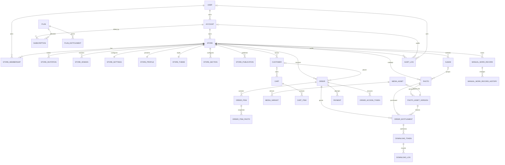

# Modelo de datos y ERD — Plataforma SaaS para fotógrafos

**Versión:** 1.2 — 17 de noviembre de 2026  
**Estado:** Modelo conceptual derivado de `02-arquitectura-tecnica.md`; requiere contraste con el esquema real antes de migraciones.

## Propósito y reglas de lectura

Este documento separa el modelo entidad-relación para facilitar su revisión. Los nombres son canónicos a nivel de dominio; no implican que todas las tablas existan ya en PostgreSQL. La implementación actual documentada solo contiene las 14 tablas de identidad, cuentas, tiendas, equipo, planes, suscripciones y auditoría indicadas en `05-estado-desarrollo-mvp.md`. El resto es modelo objetivo del MVP.

## 5. Modelo entidad-relación

Los nombres siguientes son canónicos a nivel de dominio; los nombres físicos y convenciones finales se fijarán en migraciones. Toda entidad operativa tenant-scoped incluye `store_id` directamente o queda ligada mediante una FK compuesta inequívoca.

### 5.1 Identidad, cuenta y equipo

- `users`: `id`, email normalizado único, `password_hash`, `email_verified_at`, `status`, timestamps.
- `user_sessions` / tokens de verificación y recuperación: identidad, hash del token, expiración, revocación y timestamps.
- `accounts`: `id`, `owner_user_id`, estado y datos comerciales/de facturación. Una cuenta tiene un único propietario en v1.
- `account_profiles`: `account_id`, nombre visible y perfil no sensible.
- `stores`: `id`, `account_id`, nombre, slug, `status`, `publication_status`, `sales_paused`, timestamps. Índices/unique para slug y `(id, account_id)`.
- `store_memberships`: `id`, `store_id`, `user_id`, `role` (`OWNER`, `ADMIN`, `PHOTOGRAPHER`, `EDITOR`), `status`, `invited_by_user_id`, `accepted_at`. `UNIQUE(store_id, user_id)`.
- `store_invitations`: `store_id`, email normalizado, rol propuesto, hash del token, expiración, estado y autor de invitación. No concede acceso hasta aceptación.
- `store_domains`: `store_id`, hostname normalizado único, tipo, verificación, estado y dominio primario.

Los colaboradores pueden ser miembros de varias tiendas con roles diferentes y no necesitan ser propietarios de una Account.

### 5.2 Planes y suscripciones

- `plans`: código (`base`, `intermediate`, `business`), nombre y estado.
- `plan_entitlements`: `plan_id`, `feature_key`, valor/tipo, límites y vigencia de configuración.
- `subscriptions`: `account_id`, `plan_id`, estado, inicio/fin de trial, período actual y timestamps.
- `subscription_events`: historial append-only de cambios de plan/estado y eventos de facturación.

No guardar una suscripción por tienda. Resolver la cobertura por la relación Account → Stores. Las funcionalidades consultan entitlements, no condiciones dispersas como `if plan === 'BUSINESS'`.

### 5.3 Configuración y publicación

- `store_settings`: configuración general 1:1 con tienda.
- `store_profiles`: identidad pública 1:1 con tienda.
- `store_themes`: `template_key` (inicialmente `nocturne-cyanotype`) y tokens permitidos.
- `store_sections`: `section_key`, enabled, position y contenido JSONB validado.
- `store_publications`: snapshots versionados e inmutables de la configuración publicada; como máximo una publicación actual por tienda.

El storefront público lee la publicación actual, nunca el borrador. Incluir `schema_version` en snapshots y validar/migrar snapshots cuando cambie el esquema de plantilla.

### 5.4 Catálogo y álbumes

- `albums`: `id`, `store_id`, título, descripción, portada, precio, moneda, estado, orden y timestamps.
- `photos`: `id`, `store_id`, `album_id` nullable, título, descripción, precio individual, moneda, estado, orden y timestamps.
- Una foto pertenece a cero o un álbum. No se usa tabla puente N:M.
- Debe existir `UNIQUE(id, store_id)` en ambas tablas y FK compuesta `(photos.album_id, photos.store_id) → albums(id, store_id)`.
- El borrado del álbum debe ofrecer dos operaciones de dominio: liberar fotos (`album_id = NULL`) o archivar álbum y fotos. No borrar en cascada las fotos.
- Los estados de publicación/archivo se controlan por servicio y restricciones de estado; una foto archivada no se ofrece en el catálogo.

### 5.5 Media y versionado

- `media_assets`: `id`, `store_id`, `storage_driver`, `storage_key`, checksum SHA-256, MIME real, tamaño, dimensiones, estado de procesamiento, timestamps y metadatos técnicos.
- `photo_asset_versions`: `id`, `store_id`, `photo_id`, `media_asset_id`, `version_number`, `is_current`, `created_at`, `retired_at`.
- `media_variants`: `id`, `media_asset_id`, tipo derivado (`thumbnail`, `web`, `watermarked_preview`), `storage_key`, MIME, tamaño, checksum, estado y metadatos.

Cardinalidades e invariantes:

- `Photo 1 → N PhotoAssetVersion`.
- Cada `PhotoAssetVersion` referencia exactamente un `MediaAsset`.
- Un `MediaAsset` puede estar asociado como máximo a una `PhotoAssetVersion`; puede existir sin versión para otros usos controlados (por ejemplo logo o portada), sin reutilizarlo como original de varias versiones.
- `MediaAsset 1 → N MediaVariant`.
- Una foto tiene como máximo una versión actual: índice único parcial `WHERE is_current = true` por `photo_id`.
- `UNIQUE(photo_id, version_number)`, `UNIQUE(media_asset_id)` y `UNIQUE(id, photo_id, store_id)` en versiones para permitir FKs compuestas desde snapshots y entitlements.
- Una versión no cambia de foto, tienda ni asset. Una versión referenciada por un entitlement no se elimina.
- Las variantes son regenerables y nunca sustituyen al original.

El original permanece privado. `MediaVariant` no incluye una variante pública de tipo `original`.

### 5.6 Clientes, carritos y compras

- `customers`: `id`, `store_id`, `user_id` nullable, email normalizado, nombre visible y timestamps. La vinculación posterior de un invitado requiere prueba de identidad.
- `carts`: `id`, `store_id`, `customer_id` nullable, hash de token de invitado, estado y timestamps. Como máximo un carrito abierto por identidad/tienda según la estrategia de unicidad.
- `cart_items`: `cart_id`, `store_id`, `item_type` (`photo`/`album`), referencia del ítem y datos visuales no autoritativos. El precio no se considera fuente de verdad. Preferir `photo_id` y `album_id` nullable con un `CHECK` que exija exactamente uno, y que el tipo coincida con la columna no nula, para evitar una referencia polimórfica sin FK.
- `orders`: `id`, `store_id`, `customer_id` nullable, email de invitado, `order_number`, estado comercial, subtotal/total, moneda y timestamps. No contiene `payment_status` duplicado ni `source = manual`.
- `order_items`: líneas y snapshots de título, precio, cantidad, moneda y tipo de compra.
- `order_item_photos`: composición congelada de cada pedido; cada fila registra `photo_id`, `photo_asset_version_id`, origen individual/álbum y snapshots necesarios. `UNIQUE(order_id, photo_id)` evita duplicados.
- `payments`: intentos de pago, proveedor/método, referencia externa, importe, moneda, estado, fechas de confirmación y actor que confirmó cuando sea manual. Un pedido puede tener varios intentos; un pago confirmado debe cubrir el total. Aplicar unique a `provider_payment_id` cuando exista y a la clave de idempotencia dentro del alcance definido.
- `order_entitlements`: derecho de descarga generado tras confirmar el pedido; referencia `order_id`, `store_id`, `photo_id`, `photo_asset_version_id`, fila de composición/origen, `granted_at`, `revoked_at` y motivo. `UNIQUE(order_id, photo_id)`.
- `download_tokens`: token hasheado, entitlement, expiración, propósito, uso/revocación y metadatos mínimos.
- `download_logs`: tenant, entitlement/token, resultado, bytes, IP y request ID; minimizar PII y definir retención.
- `order_access_tokens`: token hasheado de acceso a pedido invitado, expiración y revocación.

Los snapshots de composición de álbum congelan las fotos y versiones incluidas al checkout. Las fotos agregadas al álbum después no se agregan a una compra anterior.

### 5.7 Actividad manual

- `manual_work_records`: `id`, `store_id`, tipo de registro (venta externa o trabajo/servicio realizado), título/descripción, cliente opcional si corresponde, fecha, importe/moneda cuando aplique, estado, autor y timestamps.
- `manual_work_record_history`: historial append-only con `record_id`, `store_id`, actor, `change_type`, estado anterior/nuevo, diff JSONB saneado, nota y `created_at`.

`ManualWorkRecord` es un registro operativo interno, no una venta de la plataforma. No se transforma en `Order`, `Payment` ni `OrderEntitlement`, no concede descargas y no activa cobros. La analítica debe separar ventas online confirmadas de importes externos declarados manualmente.

No crear tablas `professional_services`, `service_inquiries`, `quotes`, `bookings` ni entidades de contratación en el MVP.

### 5.8 Auditoría

- `audit_logs`: append-only; `account_id`, `store_id` y `actor_user_id` como referencias lógicas cuando corresponda; `actor_type` (`user`, `system`, `platform_admin` reservado), `action`, `entity_type`, `entity_id`, `before`/`after` saneados, metadata JSONB, request ID, IP, user agent y timestamp.
- Las referencias pueden ser lógicas sin FK para preservar trazas cuando una entidad se anonimiza o retiene de forma independiente.
- Prohibir UPDATE/DELETE en auditoría y en historial de actividad; correcciones mediante nuevos eventos.

## 6. Diagrama ER conceptual

El diagrama muestra las relaciones principales. Los detalles de FKs compuestas, estados e índices se especifican en las subsecciones anteriores y no se sustituyen por el dibujo.

**Nota sobre `USER → ACCOUNT`:** el dibujo permite visualizar la relación de propiedad, pero la cardinalidad máxima por usuario depende de resolver la contradicción sobre `UNIQUE(accounts.owner_user_id)`. No generar una migración basándose solo en esa línea del diagrama.

## 7. Cardinalidades y restricciones de integridad

- `User 1 → N StoreMembership`; `Store 1 → N StoreMembership`; unique `(store_id, user_id)`.
- `Account 1 → N Store`; `Store N → 1 Account`.
- `Account 1 → N Subscription` histórica, con máximo una suscripción abierta por cuenta mediante índice parcial.
- `Plan 1 → N PlanEntitlement` y `Plan 1 → N Subscription`.
- `Store 1 → N Album`; `Album 1 → N Photo` opcional desde Photo.
- `Photo 1 → N PhotoAssetVersion`; una sola actual por foto.
- `PhotoAssetVersion 1 → 1 MediaAsset`; un asset no se reutiliza para varias versiones.
- `MediaAsset 1 → N MediaVariant`.
- `Order 1 → N OrderItem`; `OrderItem 1 → N OrderItemPhoto`.
- `Order 1 → N Payment` (intentos); los pagos parciales no se consideran confirmación válida.
- `Order 1 → N OrderEntitlement`; unique `(order_id, photo_id)`. Un trigger o una operación transaccional protegida impide insertar derechos si la orden no está confirmada.
- `OrderEntitlement N → 1 PhotoAssetVersion`, siempre de la misma foto y tienda.
- `ManualWorkRecord 1 → N ManualWorkRecordHistory`.
- `AuditLog` puede ser global, de cuenta o de tienda; sus referencias son lógicas.

### 7.1 Claves compuestas tenant-safe

Para entidades tenant-scoped crear claves únicas `(id, store_id)` y FKs compuestas que incluyan `store_id`. Ejemplos:

- `photos(album_id, store_id) → albums(id, store_id)`.
- `photo_asset_versions(photo_id, store_id) → photos(id, store_id)`.
- `order_item_photos(order_id, store_id) → orders(id, store_id)` y `(photo_asset_version_id, photo_id, store_id)` contra la versión correcta.
- `order_entitlements(order_id, store_id) → orders(id, store_id)` y referencias compuestas a foto/versión.
- `cart_items(cart_id, store_id)` y la referencia del objeto deben validar el mismo tenant.

No confiar en que la aplicación siempre envíe IDs correctos: la base debe rechazar asociaciones entre tiendas distintas.

### 7.2 Índices y constraints adicionales

- `store_domains`: unique global por hostname normalizado y unique parcial para un único dominio primario por tienda.
- `store_publications`: unique parcial para una publicación actual por tienda.
- `subscriptions`: unique parcial para una suscripción abierta por cuenta, usando la definición aprobada de estados abiertos.
- `orders`: unique `(store_id, order_number)`.
- `payments`: unique por identificador de pago del proveedor cuando no sea NULL; unique de idempotencia según el alcance acordado.
- `carts`: unique parcial para carrito abierto por cliente/identidad invitada y tienda, según la estrategia final de identidad.
- `cart_items`: `CHECK` que exija exactamente un target (foto o álbum) y coherencia con `item_type`.
- `photos`: índice por `(store_id, status, album_id, sort_order)` según consultas reales.
- `manual_work_records`: índices por `(store_id, status, occurred_at)` y `(store_id, record_type, occurred_at)`.
- `manual_work_record_history`: índices por `(record_id, created_at)` y `(store_id, created_at)`.
- `audit_logs`: índices por `store_id/created_at`, `account_id/created_at`, `actor_user_id/created_at` y `action/created_at`; GIN de metadata solo si los casos de consulta lo justifican.
- No agregar índices por anticipado sin revisar planes de consulta y costo de escritura.

### 7.3 Resultado de la revisión del ERD

El modelo actualizado cubre los dominios solicitados y corrige varias ambigüedades del esquema anterior:

1. La identidad de login (`User`) queda separada de la entidad comercial (`Account`), y `Store` pertenece a `Account`.
2. La suscripción y sus entitlements se resuelven por cuenta propietaria; no se introduce una suscripción por tienda.
3. `StoreMembership` vincula usuarios directamente con tiendas, con rol y estado por tienda; un colaborador no necesita una suscripción individual.
4. El catálogo usa `Photo.album_id` nullable y FK compuesta, no una relación N:M.
5. El original se separa de la identidad lógica `Photo` mediante `PhotoAssetVersion`; los pedidos congelan la versión exacta.
6. `Order`, `Payment`, `OrderItemPhoto` y `OrderEntitlement` quedan separados. El pedido no duplica `payment_status` ni usa `source = manual`.
7. `ManualWorkRecord` y su historial representan actividad externa/interna ya realizada, sin crear pedidos, pagos o derechos.
8. El aislamiento no depende solo del middleware: se refuerza con `store_id`, FKs compuestas, constraints, autorización y pruebas.
9. La única contradicción de cardinalidad pendiente que bloquea una constraint definitiva es si `User` puede ser propietario de más de una `Account` frente a un índice global `UNIQUE(owner_user_id)`.
10. Se admite que `MediaAsset` exista para usos de identidad/portada sin estar ligado a una versión de foto; cuando se usa como original de `PhotoAssetVersion`, no puede reutilizarse en otra versión.

La revisión es conceptual y documental; todavía no equivale a ejecutar migraciones ni a probar el esquema en una instancia PostgreSQL real.

## 8. Multi-tenancy y autorización

### 8.1 Clases de datos

- **Globales:** `users`, `plans`, `plan_entitlements`.
- **De cuenta:** `accounts`, `account_profiles`, `subscriptions`, `subscription_events`.
- **Tenant-scoped:** tiendas, membresías, invitaciones, dominios, configuración, catálogo, media, clientes, carritos, pedidos, pagos, entitlements, tokens, registros manuales e historial.
- **Transversales:** `audit_logs` y `download_logs`, con `store_id` cuando aplique y referencias lógicas.

### 8.2 Resolución del tenant

- **Storefront público:** hostname validado → `store_domains` → `store_id`.
- **Panel autenticado:** sesión `User` + `store_id` resuelto/seleccionado → membresía activa y rol. El `store_id` enviado por el cliente nunca es autorización suficiente.
- **Propietario:** `Account.owner_user_id` otorga acceso OWNER implícito a las tiendas de esa cuenta; registrar membresía OWNER para trazabilidad.
- **Invitación:** token válido y aceptado → membresía activa; una invitación pendiente no da acceso.
- **Cliente:** sesión de cliente o token de pedido verificado, siempre limitado a la tienda y compra correspondientes.
- **Descarga:** entitlement → order → store → versión → asset. Nunca aceptar ruta o `storage_key` arbitrario del cliente.
- **Webhook futuro:** referencia externa verificada → payment/order; no resolver tenant desde campos arbitrarios del payload.

### 8.3 Reglas de aislamiento

- Todas las consultas tenant-scoped filtran por `store_id` y por el ID del recurso.
- El tenant proviene de contexto confiable, no de parámetros libres.
- Las membresías suspendidas/removidas no autorizan.
- Los permisos de rol y los entitlements comerciales se evalúan de forma independiente.
- El propietario de la cuenta administra billing; un colaborador ADMIN no adquiere la propiedad de la suscripción.
- RLS de PostgreSQL puede añadirse como defensa adicional, pero no sustituye filtros, autorización, FKs ni pruebas.
- Probar acceso cruzado entre dos tiendas con IDs válidos y hostnames diferentes.

### 8.4 Roles

Roles por tienda: `OWNER`, `ADMIN`, `PHOTOGRAPHER`, `EDITOR`. El propietario de la cuenta tiene OWNER implícito en todas sus tiendas. Los roles describen perfiles; la matriz granular de permisos debe implementarse centralizadamente y probarse en backend. La habilitación del equipo es un entitlement de la cuenta, no una suscripción individual del colaborador.

## Decisiones que no deben cerrarse por inferencia

1. Resolver si un `User` puede ser propietario de más de una `Account`; no fijar `UNIQUE(accounts.owner_user_id)` hasta resolverlo.
2. Confirmar límites Business y política de downgrade.
3. Aprobar permisos granulares por rol.
4. Definir políticas de retención, reembolsos, pagos y versiones históricas.
5. Validar las FKs compuestas y restricciones en PostgreSQL real antes de considerarlas implementadas.

**Límite de validación:** este ERD es documental. No constituye prueba de que las tablas, índices, constraints o triggers ya existan en el código actual.
